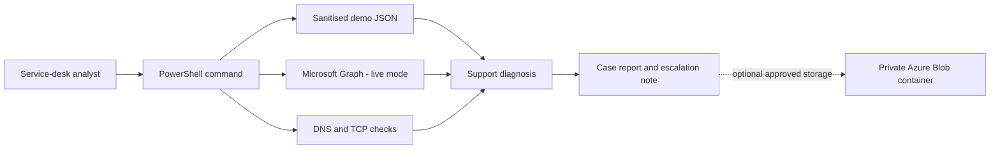

# Azure Service Desk Toolkit

I built this project to practise the Microsoft side of service-desk work instead of adding another generic cloud deployment to my portfolio. It gathers the information I would want before deciding whether a Microsoft 365 sign-in problem belongs with first line, identity, networking or the service owner.

The toolkit checks Microsoft Entra ID account state, assigned licences, registered authentication methods, the last successful sign-in, Microsoft service health and basic DNS/TCP connectivity. It turns the result into a Markdown case report with a suggested next action for each finding. It never changes the account.

## Try it without an Azure tenant

PowerShell 7 is the only requirement for demo mode. The fixture uses an invented Contoso user and the reserved `.example` domain.

```powershell
git clone https://github.com/Pantelovich/azure-service-desk-toolkit.git
cd azure-service-desk-toolkit
pwsh ./scripts/Invoke-SupportSnapshot.ps1 -Demo -CaseReference CASE-1001
```

The report is written to `reports/CASE-1001.md` and the important findings are also printed in the terminal. A committed sample is available at [`examples/example-report.md`](examples/example-report.md).

```text
[PASS] Identity: The account is enabled.
[WARNING] Licensing: No Microsoft 365 licence is assigned.
[WARNING] Authentication: No strong authentication method was found.
[WARNING] Sign-in: The last successful sign-in was 55 days ago.
[PASS] Connectivity: login.microsoftonline.com: DNS resolved and TCP 443 connected.
```

## What it checks

| Area | First-line question |
| --- | --- |
| Entra ID | Is the user present and allowed to sign in? |
| Licensing | Does the account have a Microsoft 365 licence? |
| Authentication | Is a strong authentication method registered? |
| Sign-in | When did the account last sign in successfully? |
| Service health | Is Microsoft already reporting an incident? |
| Connectivity | Can this machine resolve and reach Microsoft's sign-in and Graph endpoints on TCP 443? |

## How it fits together



## Live tenant mode

Live mode needs the `Microsoft.Graph.Authentication` module and delegated read permissions. It opens an interactive sign-in and does not accept or store a password.

```powershell
Install-Module Microsoft.Graph.Authentication -Scope CurrentUser
pwsh ./scripts/Invoke-SupportSnapshot.ps1 \
  -UserPrincipalName user@yourtenant.example \
  -CaseReference INC-1042
```

The requested permissions and the reason for each are listed in [`docs/graph-permissions.md`](docs/graph-permissions.md). Some tenants require administrator consent. Do not bypass that policy.

## Azure infrastructure

The Bicep template creates a tagged resource group, a private Blob container for approved support reports and a Log Analytics workspace. Shared-key authentication and public Blob access are disabled. Deployment is optional because demo and local report generation do not need paid Azure resources.

```bash
az login
az deployment sub what-if \
  --location uksouth \
  --template-file infra/main.bicep \
  --parameters infra/main.bicepparam
```

Run `az deployment sub create` only after reviewing the what-if output. Delete the resource group when the lab is finished to avoid charges.

## Test it

```powershell
Install-Module Pester -MinimumVersion 5.7.1 -Scope CurrentUser
Install-Module PSScriptAnalyzer -Scope CurrentUser
make lint
make test
make bicep
```

GitHub Actions runs the same PowerShell analysis, Pester tests and Bicep compilation on every push and pull request.

## Example incident

[`docs/support-scenario.md`](docs/support-scenario.md) follows a Microsoft 365 sign-in complaint from initial checks to a clear escalation. The important boundary is deliberate: this tool gathers evidence but does not reset passwords, assign licences, enable accounts or modify MFA.

## Project layout

```text
src/             PowerShell module
scripts/         Command-line entry point
examples/        Sanitised demo data
tests/           Pester tests
infra/           Azure Bicep templates
docs/            Scenario, permissions and architecture decision
reports/         Locally generated case notes (ignored by Git)
```

## Current limits

- Live mode needs a tenant where the signed-in account has the documented read permissions.
- Intune device compliance and endpoint-management checks are not included yet.
- A generated case report can contain personal data and belongs only in an approved support system.

## Licence

MIT

